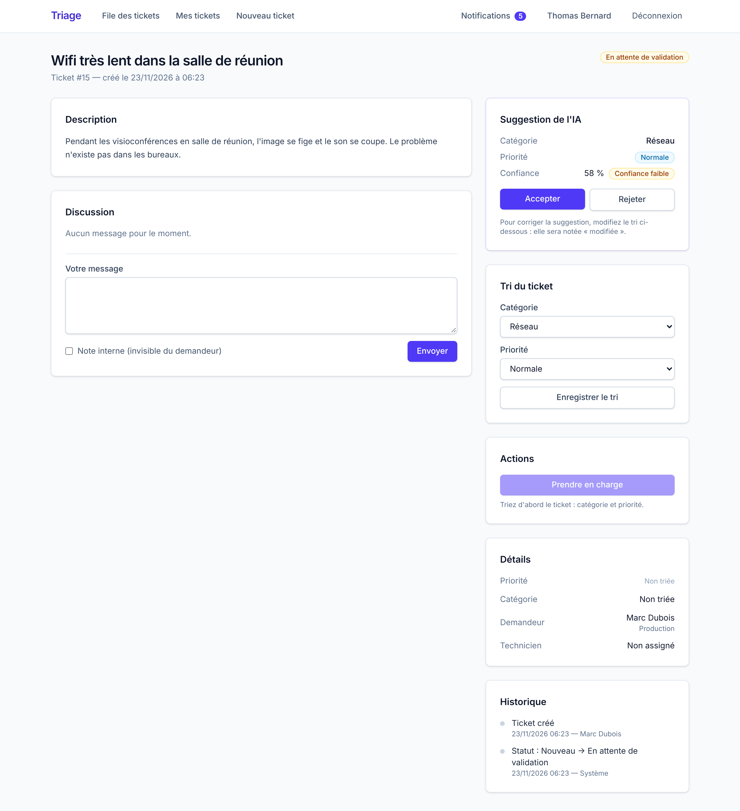
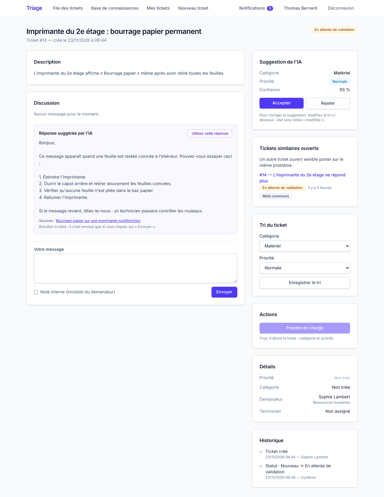

# Triage

Helpdesk interne avec tri assisté par IA — projet de BTS SIO option SLAM.

Les salariés d'une PME déclarent leurs incidents informatiques. Une IA propose une catégorie,
une priorité et une réponse ; **un technicien valide toujours avant toute action**.


## Avancement

| Phase | Contenu | État |
|---|---|---|
| 1 | Socle : authentification, rôles, tickets, machine à états, fil de discussion, notifications, CI | Terminée |
| 2 | Tri par IA : classification, anonymisation, validation par le technicien, mode dégradé | Terminée |
| 3 | Base de connaissances, réponses suggérées avec sources, détection des doublons | Terminée |
| 4 | Évaluation de l'IA et tableau de bord | À venir |
| 5 | API REST et application mobile du technicien | À venir |

## Documentation

- [Cahier des charges](docs/CAHIER_DES_CHARGES.md)
- [Modèle de données et diagrammes](docs/MODELE_DONNEES.md)
- [Journal des décisions techniques](docs/DECISIONS.md)

## Prérequis

- PHP 8.3 ou plus récent, avec les extensions `pdo_mysql` et `pdo_sqlite`
- Composer 2
- Node.js 20 ou plus récent
- MySQL 8 ou MariaDB 10.6 (ou SQLite pour un essai rapide)

## Installation pas à pas

```bash
git clone https://github.com/mohamed-ali-akir/Triage-.git triage
cd triage

# 1. Dépendances PHP et JavaScript
composer install
npm install

# 2. Configuration
cp .env.example .env
php artisan key:generate
```

Créez ensuite la base de données, puis renseignez son accès dans `.env` :

```sql
CREATE DATABASE triage CHARACTER SET utf8mb4 COLLATE utf8mb4_unicode_ci;
```

```bash
# 3. Tables et données de démonstration
php artisan migrate --seed

# 4. Compilation des feuilles de style
npm run build

# 5. Lancement
php artisan serve
```

L'application est disponible sur <http://localhost:8000>.

Pour repartir d'une base propre à tout moment (avant une démonstration par exemple) :

```bash
php artisan migrate:fresh --seed
```

### Essai rapide avec SQLite

Sans MySQL, remplacez dans `.env` le bloc `DB_*` par la seule ligne `DB_CONNECTION=sqlite`,
créez le fichier vide `database/database.sqlite`, puis reprenez à l'étape 3.

## Comptes de démonstration

Tous les comptes ont le mot de passe `password`. **Ils ne doivent jamais exister en production** :
le seeder de démonstration ne s'exécute pas quand `APP_ENV=production`.

| Rôle | Nom | Adresse e-mail |
|---|---|---|
| Administrateur | Alice Martin | `admin@triage.test` |
| Technicien | Thomas Bernard | `tech1@triage.test` |
| Technicien | Sarah Petit | `tech2@triage.test` |
| Utilisateur | Julie Moreau | `julie.moreau@triage.test` |
| Utilisateur | Karim Benali | `karim.benali@triage.test` |
| Utilisateur | Sophie Lambert | `sophie.lambert@triage.test` |
| Utilisateur | Marc Dubois | `marc.dubois@triage.test` |
| Utilisateur | Élodie Garnier | `elodie.garnier@triage.test` |

Le seeder crée aussi 15 tickets, dans tous les statuts, avec leurs messages et leur historique.

## Variables `.env` importantes

| Variable | Rôle | Valeur par défaut |
|---|---|---|
| `APP_URL` | Adresse de l'application (utilisée dans les e-mails) | `http://localhost:8000` |
| `APP_LOCALE` | Langue de l'interface | `fr` |
| `APP_TIMEZONE` | Fuseau horaire | `Europe/Paris` |
| `DB_CONNECTION`, `DB_HOST`, `DB_DATABASE`, `DB_USERNAME`, `DB_PASSWORD` | Accès à la base de données | MySQL local, base `triage` |
| `QUEUE_CONNECTION` | File d'attente | `database` |
| `MAIL_MAILER` | Envoi des e-mails. `log` les écrit dans `storage/logs/laravel.log` | `log` |
| `MAIL_FROM_ADDRESS` | Expéditeur des e-mails | `support@triage.test` |

## Tri par IA

L'IA est **désactivée par défaut** : l'application fonctionne sans elle, en tri manuel. Pour
l'activer, renseignez dans `.env` :

```dotenv
AI_ENABLED=true
AI_PROVIDER=anthropic
ANTHROPIC_API_KEY=votre-clé
```

| Variable | Rôle | Valeur par défaut |
|---|---|---|
| `AI_ENABLED` | Active le tri par IA | `false` |
| `AI_PROVIDER` | Fournisseur : `anthropic`. La valeur `fake` est réservée aux tests | `anthropic` |
| `ANTHROPIC_API_KEY` | Clé de l'API Claude. Ne la commitez jamais | vide |
| `ANTHROPIC_MODEL` | Modèle Claude utilisé | `claude-opus-5-5` |
| `ANTHROPIC_EFFORT` | Profondeur de raisonnement (`low`, `medium`, `high`) | `low` |
| `ANTHROPIC_REFUSAL_FALLBACK` | Si le modèle refuse une requête, l'API la rejoue sur un modèle de repli. À passer à `false` avec un modèle Haiku | `true` |
| `AI_TIMEOUT` | Délai maximal d'une réponse, en secondes | `30` |
| `AI_RATE_LIMIT_PER_MINUTE` | Nombre maximal d'appels à l'IA par minute | `20` |
| `AI_LOW_CONFIDENCE_THRESHOLD` | Seuil du badge « Confiance faible » | `0.7` |

Ce qui est garanti, IA activée ou non :

- Les données personnelles (e-mails, téléphones, noms, adresses IP, mots de passe) sont
  remplacées par des jetons **avant** l'envoi.
- L'IA ne modifie jamais un ticket : elle propose, un technicien accepte, corrige ou rejette.
- Si l'IA est en panne ou trop lente, le ticket part en tri manuel et rien n'est bloqué.
- Le journal `ai_logs` ne contient que des chiffres (jetons, durée, coût), jamais de texte.

Les données de démonstration contiennent des suggestions dans tous les états (en attente,
acceptée, modifiée, rejetée) sans qu'aucun appel à une IA soit nécessaire.



### Réponses suggérées et doublons

Quand un article publié de la base de connaissances correspond au ticket, l'IA rédige un
brouillon de réponse et **cite les articles utilisés**. Si aucun article ne convient, elle le dit
au lieu d'inventer. Le technicien relit le brouillon, le corrige et l'envoie lui-même.

L'application signale aussi les tickets ouverts qui semblent porter sur le même problème
(par exemple deux signalements de la même imprimante).



## File d'attente

Les notifications (et, à partir de la phase 2, les appels à l'IA) passent par une file
d'attente stockée en base de données. Il faut donc un processus qui la traite :

```bash
php artisan queue:work
```

Sans ce processus, l'application fonctionne mais les notifications restent en attente.

Le planificateur de Laravel envoie en tri manuel les tickets que l'IA n'a pas traités à temps
(par exemple si le worker est arrêté). En production, une seule ligne de cron suffit ; en
développement, lancez-le à la main :

```bash
php artisan schedule:work
```

En développement, `composer dev` lance en une commande le serveur, la file d'attente et Vite.

## Qualité

```bash
php artisan test     # tests (Pest)
composer analyse     # analyse statique (PHPStan niveau 6)
composer lint        # style du code (Pint)
composer quality     # les trois à la suite
```

La CI GitHub Actions exécute les mêmes contrôles à chaque pull request : tests sur SQLite
(PHP 8.3 et 8.4) et sur MySQL, PHPStan, Pint, `composer audit` et compilation des assets.

## Organisation du code

| Dossier | Contenu |
|---|---|
| `app/Enums` | Rôles, statuts, priorités. La machine à états est dans `TicketStatus` |
| `app/Services/Tickets` | `TicketWorkflow` (seul point d'entrée pour modifier un ticket) et `TicketNotifier` |
| `app/Services/Ai` | `AiProvider` et ses fournisseurs, `TicketClassifier`, `SuggestionReviewer`, journal des appels |
| `app/Services/Privacy` | `PiiMasker` : anonymisation avant envoi à l'IA |
| `app/Services/Kb` | Recherche dans la base de connaissances (plein texte MySQL, repli par mots-clés) |
| `app/Jobs` | Les trois traitements en file d'attente : classification, réponse suggérée, doublons |
| `resources/prompts` | Les prompts envoyés à l'IA |
| `app/Actions` | Opérations partagées entre le web et la future API (créer un ticket, publier un message) |
| `app/Policies` | Règles d'accès à un ticket |
| `app/Livewire` | File du technicien et fil de discussion |
| `app/Http` | Contrôleurs, Form Requests, middleware |
| `database/seeders` | Données de référence et données de démonstration |
| `tests` | Tests de fonctionnalité (`Feature`) et unitaires (`Unit`) |
