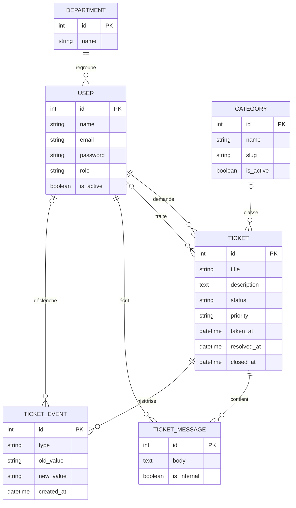
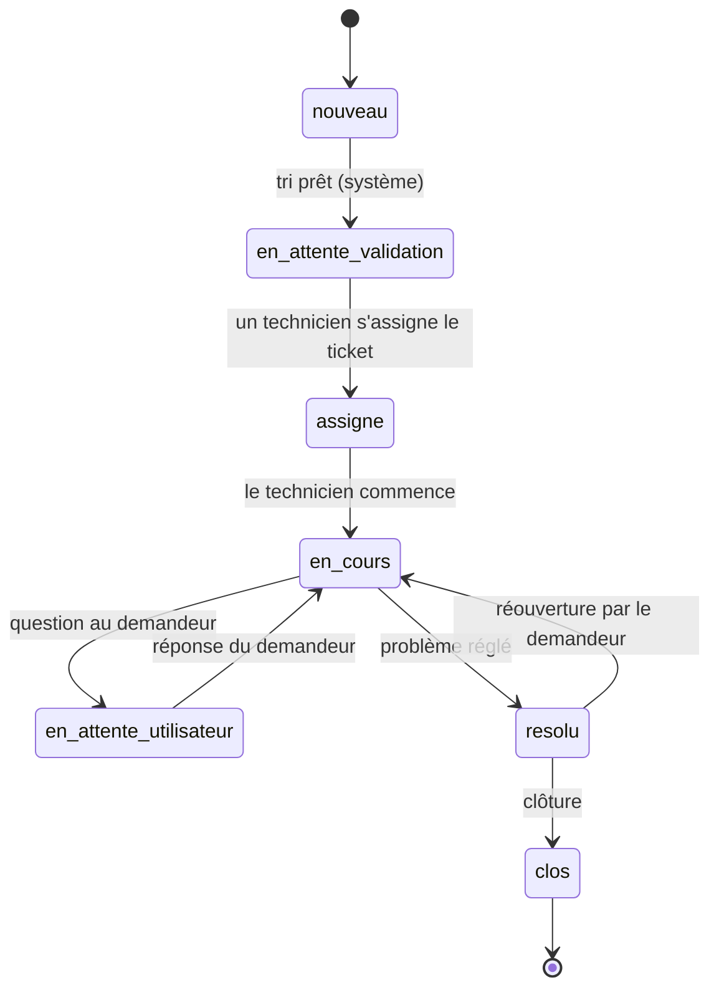
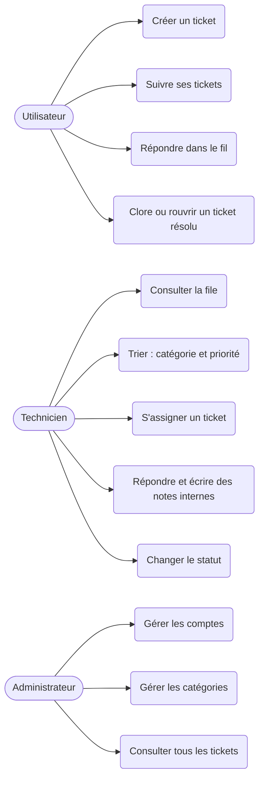

# Modèle de données et diagrammes

GitHub affiche directement les schémas Mermaid ci-dessous.

## 1. MCD (phase 1)

Lecture des cardinalités :

- Un service regroupe 0 à n utilisateurs ; un utilisateur appartient à 0 ou 1 service.
- Un utilisateur demande 0 à n tickets ; un ticket a exactement 1 demandeur.
- Un technicien traite 0 à n tickets ; un ticket a 0 ou 1 technicien assigné.
- Une catégorie classe 0 à n tickets ; un ticket a 0 ou 1 catégorie (0 tant qu'il n'est pas trié).
- Un ticket contient 0 à n messages et 0 à n événements.
- Un événement a 0 ou 1 auteur : 0 quand c'est le système qui agit.

## 2. MLD (phase 1)

Les clés primaires sont soulignées par la mention PK, les clés étrangères sont précédées de `#`.

- **departments** (id PK, name, created_at, updated_at)
- **users** (id PK, name, email, password, role, is_active, #department_id, colonnes de double
  authentification, remember_token, created_at, updated_at)
- **categories** (id PK, name, slug, is_active, created_at, updated_at)
- **tickets** (id PK, title, description, status, priority, #category_id, #requester_id,
  #assignee_id, taken_at, resolved_at, closed_at, created_at, updated_at)
- **ticket_messages** (id PK, #ticket_id, #user_id, body, is_internal, created_at, updated_at)
- **ticket_events** (id PK, #ticket_id, #user_id, type, old_value, new_value, created_at)

Contraintes :

| Colonne | Contrainte |
|---|---|
| `users.email` | unique |
| `users.department_id` | nullable, `ON DELETE SET NULL` |
| `categories.slug` | unique |
| `tickets.requester_id` | obligatoire, `ON DELETE RESTRICT` |
| `tickets.assignee_id` | nullable, `ON DELETE SET NULL` |
| `tickets.category_id` | nullable, `ON DELETE RESTRICT` |
| `tickets.priority` | nullable (vide tant que le ticket n'est pas trié) |
| `ticket_messages.ticket_id`, `ticket_events.ticket_id` | `ON DELETE CASCADE` |
| `ticket_events.user_id` | nullable (action du système) |

Index : `tickets (status)`, `tickets (requester_id)`, `tickets (assignee_id)`.

## 3. Machine à états du ticket

## 4. Cas d'utilisation

## 5. Tables prévues pour les phases suivantes

| Table | Phase | Rôle |
|---|---|---|
| `ai_suggestions` | 2 | Proposition de l'IA pour un ticket et décision du technicien |
| `ai_logs` | 2 | Journal technique des appels à l'IA, sans contenu |
| `kb_articles` | 3 | Articles de la base de connaissances |
| `ai_suggestion_kb_article` | 3 | Articles cités par une suggestion (table de liaison) |

Leur MCD sera ajouté ici au début de chaque phase.
